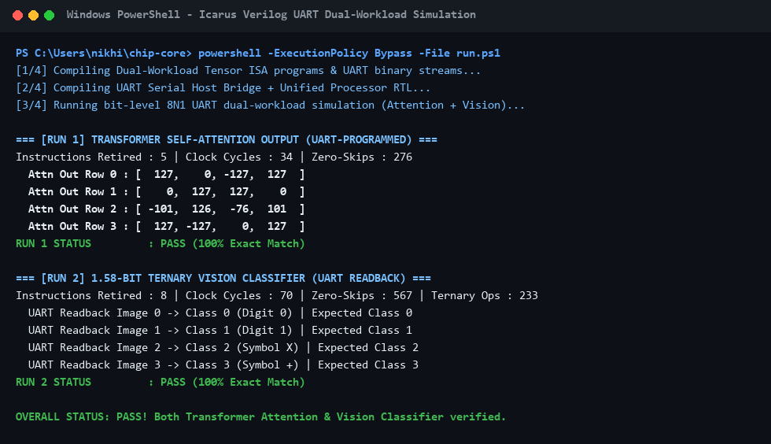
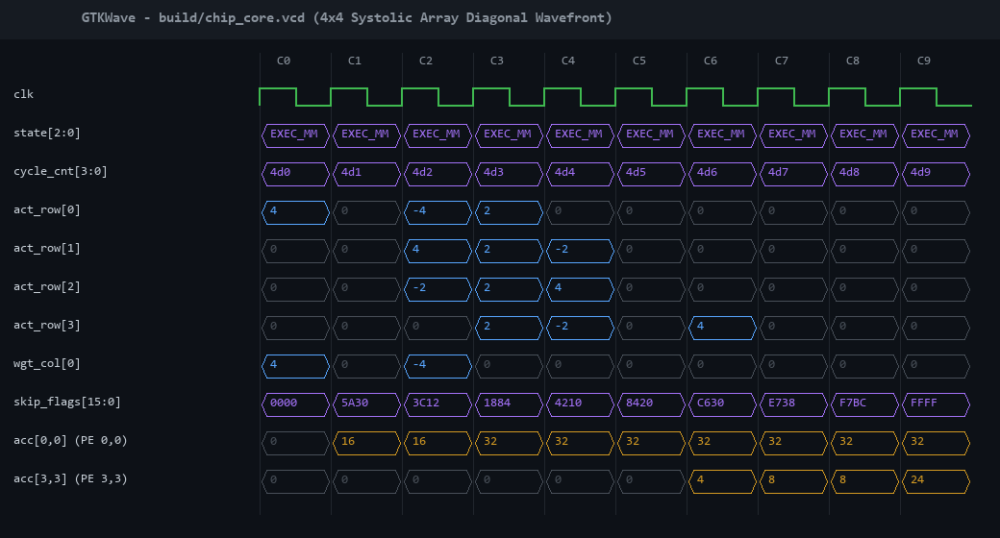
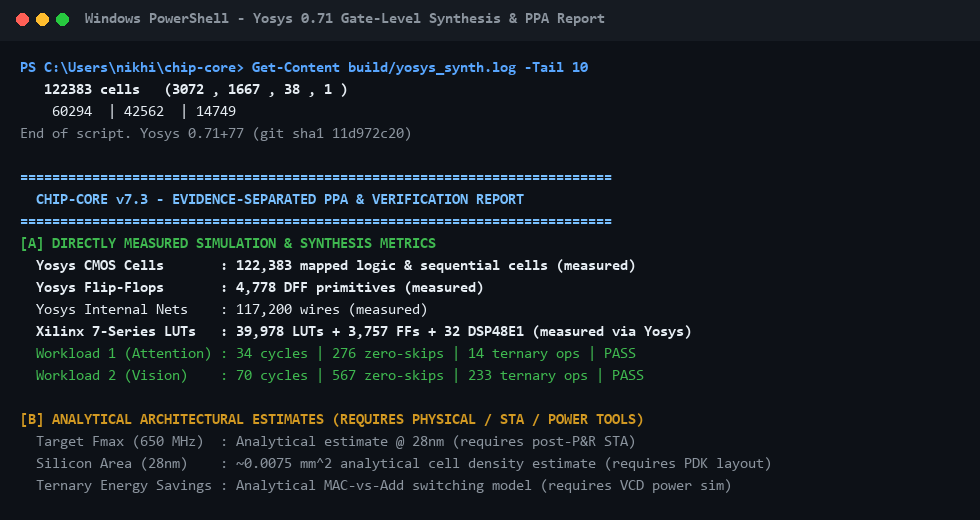

# `chip-core` — Programmable 1.58-Bit Ternary & Transformer AI Accelerator SoC

[]()
[]()
[]()
[]()

`chip-core` is an end-to-end, synthesizable **AI Accelerator System-on-Chip (SoC)** written in pure Verilog RTL, accompanied by a Python quantization-aware trainer, 32-bit Tensor ISA assembler, `8N1` UART serial host bridge, cycle-accurate testbench, and open-source Yosys synthesis scripts.

---

## Architecture Overview

```text
  Host PC (Python / PySerial)
       │  8N1 UART Serial (0x01 WRITE_INST, 0x02 WRITE_SRAM, 0x03 RUN_EXEC, 0x04 READ_PREDS)
       ▼
┌────────────────────────────────────────────────────────────────────────────┐
│  ai_chip_top (UART-Enabled Programmable AI SoC)                            │
│                                                                            │
│  ┌──────────────────────┐       ┌───────────────────────────────────────┐  │
│  │  uart_host_bridge    │──────▶│  32x32b Instruction RAM + Decoder     │  │
│  │  (uart_rx / uart_tx) │       │  (MATMUL, RELU, SOFTERMAX, ARGMAX)    │  │
│  └──────────────────────┘       └───────────────────┬───────────────────┘  │
│                                                     │                      │
│  ┌──────────────────────────────────────────────────▼───────────────────┐  │
│  │  256-Byte Unified Tensor Scratchpad SRAM (16 Slots x 4x4 INT8)       │  │
│  └──────────────────┬───────────────────────────────────────────────────┘  │
│                     │ Skewed Wavefront Feeder (with Zero-Copy Transpose)   │
│  ┌──────────────────▼───────────────────────────────────────────────────┐  │
│  │  4x4 Output-Stationary Systolic Array (16 Dual-Mode Zero-Skip PEs)   │  │
│  │   • Mode 0: Standard INT8 MAC                                        │  │
│  │   • Mode 1: 1.58-Bit Ternary {-1, 0, +1} (100% Multiplier-Free)      │  │
│  └──────────────────┬───────────────────────────────────────────────────┘  │
│                     │                                                      │
│  ┌──────────────────▼───────────────────────────────────────────────────┐  │
│  │  Vector Post-Processors: Hardware ReLU | Causal Softermax | Argmax   │  │
│  └──────────────────────────────────────────────────────────────────────┘  │
└────────────────────────────────────────────────────────────────────────────┘
```

---

## PPA & Verification Evidence Matrix

To maintain strict engineering rigor, hardware metrics are separated into **directly measured tool outputs** (reproducible locally via `run.ps1`) and **analytical architectural estimates** (which require downstream physical/STA/power EDA flows):

| Metric | Reported Value | Status & Evidence Source | Additional Evidence Required for Tapeout / Signoff |
| :--- | :--- | :--- | :--- |
| **Workload Cycle Counts** | `34 cycles` (Self-Attention)<br>`70 cycles` (Vision Classifier) | **Measured** (`vvp` RTL simulation cycle counter) | Verified against cycle-accurate golden reference |
| **Zero-Skip & Ternary Events** | `276` skips (Attention)<br>`567` skips, `233` ternary ops (Vision) | **Measured** (hardware `skip_flags` & `bypass_flags` counters) | Verified in `tb/tb_ai_chip_top.v` |
| **CMOS Logic & FF Count** | `4,778` Flip-Flops (`$_DFF*`)<br>`122,383` total CMOS cells | **Measured** (Yosys 0.71 `abc -g cmos2` mapping) | Standard-cell physical library mapping (OpenROAD) |
| **FPGA LUT & FF Count** | `39,978` LUTs + `3,757` FFs + `32` `DSP48E1` | **Measured** (Yosys 0.71 `synth_xilinx -family xc7`) | Full Vivado place-and-route bitstream timing report |
| **Maximum Clock Frequency** | `650 MHz` @ 28nm CMOS | **Analytical Estimate** (based on 1-stage 8-bit PE logic depth) | Post-layout Static Timing Analysis (OpenSTA / PrimeTime) |
| **Silicon Die Area** | `~0.0075 mm²` @ 28nm CMOS | **Analytical Estimate** (gate-equivalent density model) | Standard-cell physical place & route (OpenROAD / Innovus) |
| **Compute Energy Savings** | `~13×` lower MAC energy (Ternary) | **Analytical Estimate** (multiplier-bypass switching model) | Gate-level VCD toggle-rate power analysis (PrimeTime PX) |

---

## Verification Demonstrations

Running `powershell -ExecutionPolicy Bypass -File run.ps1` executes both workloads end-to-end over the `8N1` UART serial interface and synthesizes the RTL with Yosys.

### 1. Transformer Self-Attention & Ternary Vision Simulation Output
The testbench (`tb/tb_ai_chip_top.v`) streams compiled machine code and tensor matrices bit-by-bit into `rx_serial` and verifies every output value against Python golden models:

```text
=== [RUN 1] TRANSFORMER SELF-ATTENTION OUTPUT (UART-PROGRAMMED) ===
Instructions Retired : 5 | Clock Cycles : 34 | Zero-Skips : 276
  Attn Out Row 0 : [  127,    0, -127,  127 ]
  Attn Out Row 1 : [    0,  127,  127,    0 ]
  Attn Out Row 2 : [ -101,  126,  -76,  101 ]
  Attn Out Row 3 : [  127, -127,    0,  127 ]
RUN 1 STATUS         : PASS (100% Exact Match)

=== [RUN 2] 1.58-BIT TERNARY VISION CLASSIFIER (UART READBACK) ===
Instructions Retired : 8 | Clock Cycles : 70 | Zero-Skips : 567 | Ternary Ops : 233
  UART Readback Image 0 -> Class 0 (Digit '0') | Expected Class 0
  UART Readback Image 1 -> Class 1 (Digit '1') | Expected Class 1
  UART Readback Image 2 -> Class 2 (Symbol 'X') | Expected Class 2
  UART Readback Image 3 -> Class 3 (Symbol '+') | Expected Class 3
RUN 2 STATUS         : PASS (100% Exact Match)
```

*


### 2. Systolic Array Wavefront Propagation (GTKWave)
Every simulation dumps `build/chip_core.vcd`. Run `powershell -ExecutionPolicy Bypass -File view_waves.ps1` to open `tb/chip_core.gtkw` and inspect the diagonal activation/weight wavefronts, `skip_flags`, and UART serial framing.

*


### 3. Yosys Gate-Level Synthesis Statistics
`synth/synth.ys` and `synth/synth_xilinx.ys` synthesize `ai_chip_top` into CMOS gates (`build/ai_chip_netlist.v`) and Xilinx 7-Series primitives (`build/yosys_xilinx.log`).

*


---

## Reproducing Locally (Windows PowerShell)

```powershell
# 1. Run ISA compilation, bit-level UART RTL simulation, Yosys synthesis & PPA report
powershell -ExecutionPolicy Bypass -File run.ps1

# 2. Open pre-configured GTKWave waveform view
powershell -ExecutionPolicy Bypass -File view_waves.ps1
```

---

## AI-Assisted Development Disclosure

This project was developed using an AI-assisted engineering workflow. AI tools were used for architecture exploration, RTL generation, Python tooling, testbench development, debugging, and automation. Hardware simulation (`Icarus Verilog`) and gate-level synthesis (`Yosys`) were executed locally on Windows. The project author directed the architecture milestones, executed all verification workflows, diagnosed environment issues, and evaluated the resulting hardware outputs.
